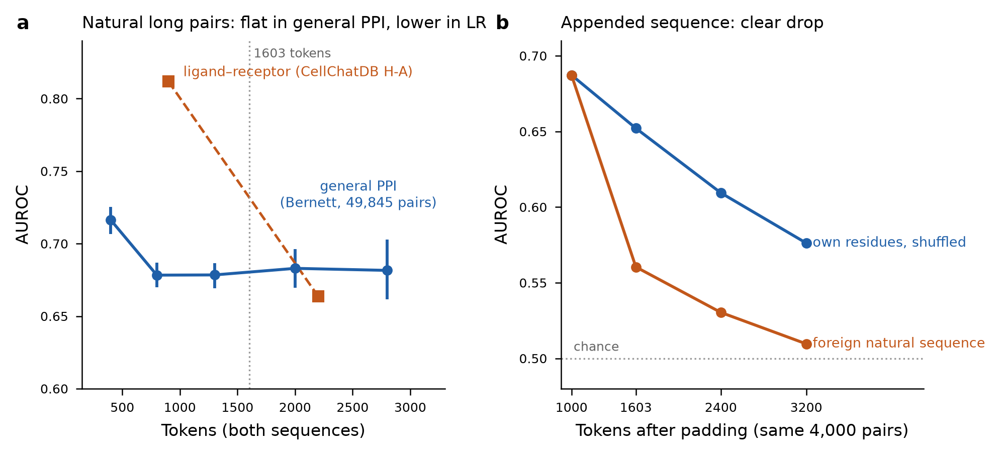

# 实验一:V12 在长、短蛋白配对上的区分能力 —— 结果

计划 `plan.md`(提交 c3e22aa);结果提交 03e1d91。打分 28591 秒(约 7.9 小时,2 个进程)。
本文件的数字都来自 `summary/`;第 4 节第 2 条和第 5 节的类别分层是探索性的(计划没有登记),数据在 `explore_lr_by_class.csv`。

## 1. 预注册判定

| 部分 | 判定 | 数值 |
|---|---|---|
| E1 天然长配对(一般 PPI) | **没有实质差异**(`no_material_difference`) | Δ = AUROC_短 − AUROC_长 = +0.0089,区间 [-0.003, 0.022];短 0.689,长 0.680 |
| E2 人为加长(T = 2400) | **长度本身降低区分能力**(`length_itself_lowers_discrimination`) | 外源序列 Δ = 0.157 [0.135, 0.177];自身打乱 Δ = 0.078 [0.064, 0.092] |

按计划第 6 节,E1 为"没有实质差异"时结论是:**长度不是 V12 的主要问题;小鼠面板上的长度差异要另找原因**。E2 的结果另外报告,见第 3 节。

## 2. E1 明细(主分析集 49,845 对:正 23,984、负 25,861)

- 样本:短配对 正 20,075 / 负 21,749;长配对 正 3,909 / 负 4,112。
- 按训练重叠分层(Δ 为短 − 长):

  | 层 | AUROC 短 | AUROC 长 | Δ [95% 区间] | 长配对正 / 负 |
  |---|---|---|---|---|
  | 两个蛋白都在训练中出现过 | 0.694 | 0.672 | +0.022 [0.003, 0.040] | 1,677 / 1,733 |
  | 只出现过一个 | 0.696 | 0.683 | +0.014 [-0.005, 0.033] | 1,821 / 1,907 |
  | 都没出现过 | 0.643 | 0.706 | -0.063 [-0.099, -0.025] | 411 / 472 |

  三层方向不一致:前两层短配对略好(0.02 左右),"都没出现过"一层反而是长配对更好。
- 按蛋白随机对半划分 20 次:40 个 Δ 在 -0.024 到 +0.043 之间,77.5% 与总体同号。
- 分段(AUROC [95% 区间]):<=600 0.716 [0.707, 0.725];601-1000 0.678 [0.670, 0.687];1001-1603 0.678 [0.669, 0.687];1604-2400 0.683 [0.670, 0.696];>2400 0.682 [0.662, 0.703]。
  只有最短一段(≤ 600 token)略高,601 token 以上基本持平,超过 1603 token 也没有下降。
- 含有比 V12 训练集中任何蛋白都长(> 1,996 aa)的长配对:AUROC 0.685 [0.664, 0.707](正 1,111);其余长配对 0.683 [0.669, 0.696]。没有差别。
- 描述性:正样本分数中位数 短 0.0012、长 0.0276;AUPR 短 0.685、长 0.661。
- **整体水平:** 在这个数据集上 V12 的 AUROC 只有约 0.68–0.72,明显低于它在 LR 基准 H-M 上的 0.81。Bernett 数据专门去掉了常见的捷径(负样本中蛋白的出现次数与正样本相近),序列模型在上面普遍表现偏低。

## 3. E2 明细(同一批 4,000 对,原始 ≤ 1000 token)

| 补法 | 原始 | 1603 | 2400 | 3200 |
|---|---|---|---|---|
| 自身打乱 | 0.687 | 0.652(Δ 0.035) | 0.609(Δ 0.078) | 0.576(Δ 0.111) |
| 外源天然序列 | 0.687 | 0.560(Δ 0.127) | 0.530(Δ 0.157) | 0.510(Δ 0.178) |

- 加长越多,AUROC 越低,两种补法都是单调下降。
- 外源天然序列的影响大得多:只补到 1603 token(仍在训练长度以内),AUROC 就从 0.687 降到 0.560;补到 3200 时接近随机(0.510)。
- 正样本分数的中位数,外源补法下从 0.0010 降到 0.0001。

## 4. LR 复制分析(H-A,V12 已有分数;计划中登记为描述性)

- 单基因、非同源配对,正样本对随机负样本,去掉训练中出现过的配对。短 0.812,长 0.664,**Δ = 0.148 [0.109, 0.188]**(长配对正 291 / 负 2,377)。
- 两个训练重叠层都一样:蛋白都见过 Δ = 0.101 [0.033, 0.172];至少一个没见过 Δ = 0.187 [0.140, 0.236]。
- **探索性:按配体类别分层后差距仍在**(正样本 / 负样本数见 `explore_lr_by_class.csv`):
  - Contact:短 0.875,长 0.657,Δ = 0.218 [0.160, 0.272](长配对正 126)
  - ECM:短 0.763,长 0.635,Δ = 0.128 [0.025, 0.226](长配对正 119)
  - Secreted:短 0.798,长 0.664,Δ = 0.134 [0.046, 0.223](长配对正 46)
  所以 LR 中长配对较差,不能用"长配对多是接触型 / ECM"来解释。

图:a 中蓝线为 Bernett 主分析集各长度段的 AUROC(竖线为 95% 区间);橙色方块为 LR 复制分析中短配对(≤ 1603 token)和长配对的 AUROC,横坐标位置只是示意。b 为 E2:同一批 4,000 对补到不同长度后的 AUROC。

## 5. 解读

1. **长度本身不是 V12 的通病。** 在约 5 万对一般 PPI 上,天然的长配对并不比短配对差。即使含有比训练集中任何蛋白都长的蛋白,也是如此。
2. **V12 怕的是"不属于这个蛋白的序列"。** E2 中补上的序列不改变原有的相互作用部分,AUROC 却明显下降;补上的是天然蛋白片段时下降最多,即使总长度还在 1603 token 以内。
   天然长蛋白多出来的部分是它自己的结构域,模型在训练中见过这种蛋白;人为拼接出的嵌合序列则超出了训练分布。
3. **LR 配对是例外。** LR 中长配对差了约 0.15,而且分类别后仍然存在。这说明问题出在 LR 中那些长蛋白本身(多为大型膜受体和细胞外基质蛋白),而不是一般意义上的长度。
   一个可能的解释(未检验):这些受体真正参与结合的胞外区只占全长的一小部分,其余是跨膜区和胞内区,对 V12 来说,效果可能类似 E2 中"多余的序列"。
4. **对"裁剪 / 胞外段打分"的含义:不建议做。** E2 表明对序列做任何人为改动都可能把 V12 推出训练分布;此前 V11 只用胞外段打分时,AUROC 从 0.872 降到 0.739(`plm_lr_benchmark` 第 4.2 节)。
   即使第 3 条的解释成立,裁剪也是另一种人为改动;现有两项证据都显示,这类改动会让 V12 变差。

## 6. 对实验二的含义

1. 实验一没有给出增加"裁剪后重新打分"这种 S 的理由,实验二按草稿进行:不加 S、原始 S、老师的 S′。
2. 实验二草稿中的敏感性分析"长序列配对改用同类型中位数"仍然保留:按 LR 复制分析,小鼠面板上的长配对分数信息较少。

## 7. 局限

1. Bernett 数据是一般 PPI,结论 1、2 来自它;LR 的结论(第 4 节)只有约 1,000 个正样本,而且类别分层是探索性的。
2. Bernett 负样本是随机抽取的无互作记录配对,不是实验阴性。
3. E2 补上的不是真实结构域,所以只能说明"外来序列"的影响,不能直接推到真实的长蛋白上。
