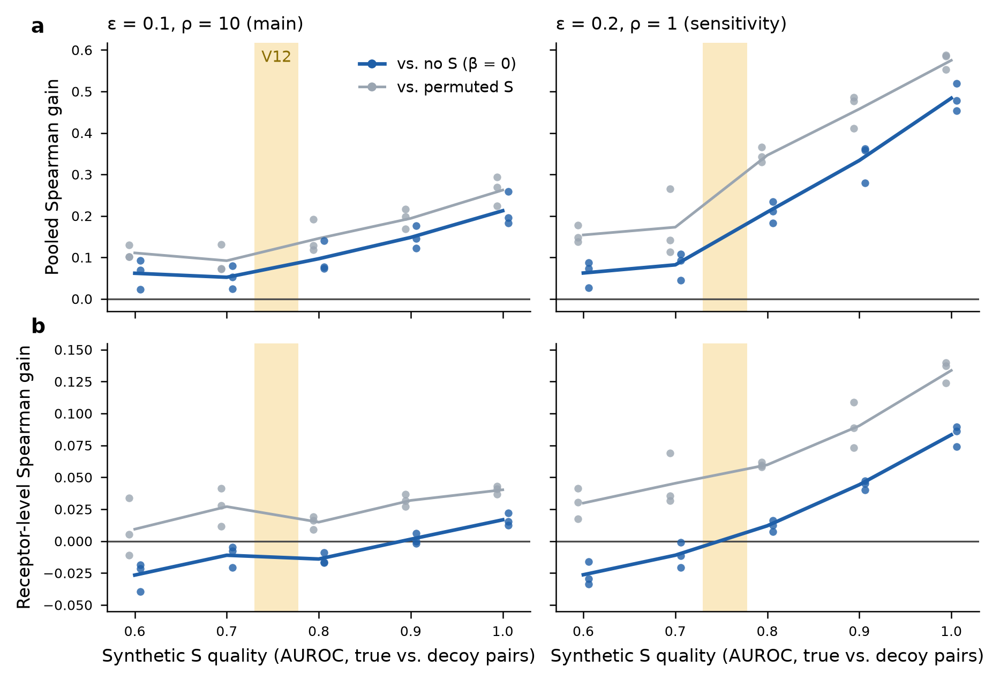

# 注入实验 01:结果

计划 `plan.md`(提交 accf094);修订 01 `amendment_01.md`(e6023d3,GPU 求解);修订 02 `amendment_02.md`(0827e6d,主设置的收敛标准);结果提交 0282040。
数据:10x Visium `V1_Mouse_Brain_Sagittal_Posterior` 中心 400 个 spot(真实坐标与表达),CellChatDB v2 小鼠面板;真值和 S 均为合成(plan.md 第 2、3 节)。
本文件中的数字都由 `summary/` 下的文件计算;图和表的数据在 `inject01_gain_vs_quality.csv`。

## 1. 运行与收敛

- 两种设置各 318 次求解,共 636 次,GPU(`gpu_env.txt`),等价门槛通过。正式 OT 用时 31463 秒,稳定性复查 7130 秒。
- 主设置(ε = 0.1、ρ = 10):318 次全部到 200,000 次上限,求解器检查全部通过;按修订 02 记为收敛(`runs_at_cap` = 318,`runs_not_converged` = 0)。
- 稳定性诊断(修订 02 第 3 节):36 次求解在 400,000 次与 200,000 次之间,最大差为合并 Spearman 1.4e-04,其余各项 ≤ 7e-06;判断为“接受”。这个差远小于下文的增益(R3 格子上合并指标的单种子增益最小为 0.023)。
- 敏感性设置(ε = 0.2、ρ = 1):317 次在第 41 次迭代、1 次在第 31 次迭代时达到停止判据,按 plan.md 原规则全部收敛。

**标签:** 修订 02 提交之前,插件在诊断时看过主设置 `s1_none` 的一行指标。按修订 02 第 4 节,主设置的判定标为**探索性**。
那一行只是基线,不含任何对比,推不出 R1–R5 中的任何一项。敏感性设置完全按 plan.md 判定,不受影响,是本实验的确认性结论;它与主设置的判定完全相同。

## 2. 预注册判定

| 判定 | 主设置(探索性) | 敏感性设置(预注册) |
|---|---|---|
| R1 框架能用上 S | True | True |
| R2 最优 β(q100, raw) | 1.0 | 1.0 |
| R2 是否落在 {ε/2, ε, 2ε} | False | False |
| R3 质量门槛(AUROC) | 0.6 | 0.6 |
| R3 是否单调 | True | True |
| R5 受体层能否看出 | True | True |
| R4 V12 的定位 | AUROC 0.754 [0.730, 0.778],门槛 0.6,above | 同左,above |

按 plan.md 第 5 节的结论表(R1 是、R4 越过、R5 是):**可以进入真实切片的置换检验(另写计划)。**

需要说明的两点:
1. R2:最优 β 是网格的上端 1.0,即原公式 C = −log F − log S,不在预测的 {ε/2, ε, 2ε} 内。主设置在 β = 0.5 到 1 之间仍略有上升,真正的最优可能 ≥ 1。
2. R3:测过的五档全部“可用”,门槛 0.6 是最低一档,所以真实门槛只能写成“≤ 0.6”。门槛是按“相对打乱版本”定义的(见第 4 节第 2 条)。

## 3. 效应大小

在 R3 选出的格子上(用种子 1 选,种子 2、3 确认),3 个种子的平均值。增益 = 指标减去同种子 `none`;相对打乱 = 减去同格子的打乱版本。

**主设置 ε = 0.1、ρ = 10(探索性)**。`none` 基线:合并 Spearman 0.346, 0.368, 0.403,受体层 0.689, 0.679, 0.667,诱饵运输量占比 0.373, 0.363, 0.330(种子 1–3)。

| S 质量(AUROC) | 格子 | 合并:相对 none | 合并:相对打乱 | 受体层:相对 none(>0 的种子数) | 受体层:相对打乱 | 诱饵运输量占比 |
|---|---|---|---|---|---|---|
| 1.0 | raw, β = 1 | +0.212 | +0.262 | +0.017(3/3) | +0.040 | 0.256 |
| 0.9 | raw, β = 1 | +0.148 | +0.194 | +0.001(2/3) | +0.032 | 0.279 |
| 0.8 | raw, β = 1 | +0.097 | +0.146 | -0.014(0/3) | +0.015 | 0.305 |
| 0.7 | raw, β = 1 | +0.052 | +0.092 | -0.011(0/3) | +0.027 | 0.310 |
| 0.6 | raw, β = 1 | +0.062 | +0.111 | -0.027(0/3) | +0.009 | 0.296 |

**敏感性设置 ε = 0.2、ρ = 1(预注册)**。`none` 基线:合并 Spearman 0.370, 0.416, 0.449,受体层 0.727, 0.726, 0.745,诱饵运输量占比 0.371, 0.359, 0.321(种子 1–3)。

| S 质量(AUROC) | 格子 | 合并:相对 none | 合并:相对打乱 | 受体层:相对 none(>0 的种子数) | 受体层:相对打乱 | 诱饵运输量占比 |
|---|---|---|---|---|---|---|
| 1.0 | raw, β = 1 | +0.484 | +0.575 | +0.083(3/3) | +0.134 | 0.000 |
| 0.9 | raw, β = 1 | +0.334 | +0.458 | +0.044(3/3) | +0.090 | 0.062 |
| 0.8 | raw, β = 1 | +0.209 | +0.346 | +0.012(3/3) | +0.060 | 0.168 |
| 0.7 | raw, β = 1 | +0.082 | +0.173 | -0.011(0/3) | +0.045 | 0.267 |
| 0.6 | raw, β = 0.2 | +0.062 | +0.154 | -0.026(0/3) | +0.030 | 0.268 |

图:a 为合并 Spearman,b 为受体层 Spearman。横轴是合成 S 的质量,点为单个种子,线为 3 个种子的平均;格子同上表。黄色区间是 V12 的 AUROC 95% 区间(0.730–0.778;它衡量的是面板配对 vs 未注释组合,与横轴的定义不同,见第 5 节)。

## 4. 探索性发现(计划中没有预先登记)

1. **在 V12 所在的质量区间,受体层指标比不用 S 更差。** 对每一档,在全部 10 个格子(2 种归一化 × 5 个 β)中取受体层“相对 none”增益平均值最大的格子:
   - 主设置:0.9:+0.0060(raw, β = 0.05;3 个种子都 > 0:是);0.8:-0.0003(ligand, β = 0.05;3 个种子都 > 0:否);0.7:-0.0070(ligand, β = 0.05;3 个种子都 > 0:否);0.6:-0.0131(raw, β = 0.05;3 个种子都 > 0:否)。
   - 敏感性设置:0.9:+0.0442(raw, β = 1;3 个种子都 > 0:是);0.8:+0.0190(raw, β = 0.1;3 个种子都 > 0:是);0.7:-0.0023(ligand, β = 0.05;3 个种子都 > 0:否);0.6:-0.0131(raw, β = 0.05;3 个种子都 > 0:否)。
   也就是说,质量在 0.7–0.8 时,没有任何格子能让受体层指标在 3 个种子上都高于不用 S。受体层指标是真实靶基因评价的对应物。
   受体层要稳定变好,主设置需要质量约 0.9,敏感性设置约 0.8。合并 Spearman 则在所有质量档都高于不用 S。
2. **“相对打乱”比“相对 none”容易满足。** 打乱的 S 本身会让结果变差(上表中“相对打乱”总是大于“相对 none”)。
   所以 R3 的“可用”意思是“S 里的配对信息有作用”,不是“比不用 S 更好”。
3. **按配体归一化(S′ = S / Σ S,导师的建议)在合并指标上始终不如原始 S。** 各格子中“相对 none”的最大合并增益:
   - 主设置:1.0 档 raw +0.212 / ligand +0.194;0.8 档 raw +0.097 / ligand +0.084;0.7 档 raw +0.052 / ligand +0.042。
   - 敏感性设置:1.0 档 raw +0.484 / ligand +0.258;0.8 档 raw +0.209 / ligand +0.114;0.7 档 raw +0.089 / ligand +0.055。
   均匀对照 1/k 不带任何配对信息,β = 1 时合并增益为主设置 -0.0043、敏感性设置 -0.0955,即没有帮助或有害。
4. **ρ = 10 时诱饵关不掉。** 即使用完全准确的 S(q100),主设置的诱饵运输量占比仍有约 0.26(none 约 0.33–0.37);敏感性设置降到 0.00。
   这与本地预试一致:边际约束强时,S 只能在配对之间重新分配运输量,不能把错误的配对关掉。这可能是主设置的增益明显小于敏感性设置的原因之一。

## 5. 对第二步(真实切片置换检验)的含义

1. 这次实验证明的是:S 有信息时,这个 cost 能用上它;V12 的 AUROC 高于合成门槛。它**没有**证明 V12 在真实数据上有用。
   两个 AUROC 的定义不同:合成 S 是面板内真实配对 vs 诱饵,噪声独立无偏;V12 的 0.754 是面板配对 vs 未注释组合。
   V12 的误差还有结构:长序列(>1603 token)AUROC 只有 0.645;同源互作抬高分数;约一半多受体配体的 S′ 接近 1/k(`reports/stage2_ppi_01/results.md`)。
2. 按第 4 节第 1 条,在 V12 的质量下,**相对打乱的 V12** 可能检出差异,**相对 S = 1(现在的 Stage 2)** 在靶基因评价上预计不会更好,甚至略差(约 −0.01)。
   第二步计划应把这两个比较分开预注册,并事先写明:如果只有前者成立,结论是“V12 带有配对信息,但目前不足以改进推断”。
3. 选格子:按 plan.md,第二步使用 R3 选出的(归一化, β)。0.7、0.8 两档在两种设置下选出的都是 raw、β = 1。
4. 效应很依赖 S 的质量(图 a、b 的斜率)。第二步可以把“只用 ≤ 1603 token 的配对”(V12 在这些配对上 AUROC 0.813)作为预注册的敏感性分析。

## 6. 局限

1. 真值是人为规定的规则(plan.md 第 2 节),结论只在这个规则下成立。
2. 合成 S 的噪声模型是简化:独立、无偏,没有长度偏好或同源互作这类结构性误差。
3. 只用了后部切片中心的 400 个 spot;诱饵比例 1/3、K 跨两个数量级、λ = 100 µm 都固定,没有扫描。
4. 门槛只测到 0.6;β 只测到 1。
5. 每档质量只有 3 个种子,单个格子上种子间差别不小(图中的点),例如主设置 0.6 档的合并增益略高于 0.7 档。
