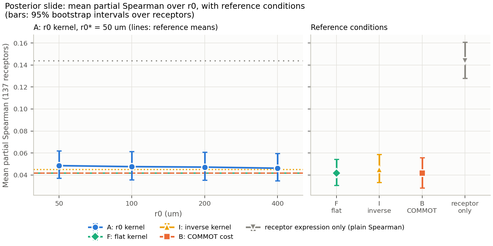
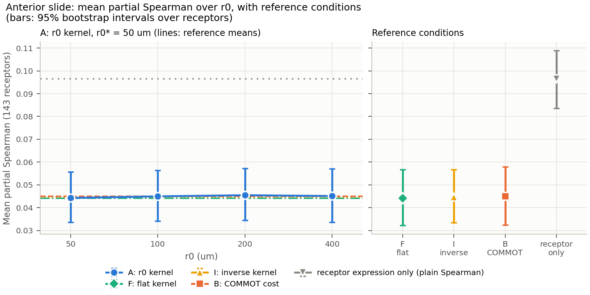
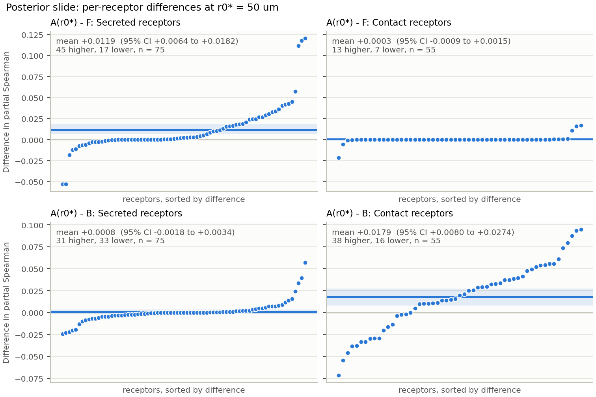
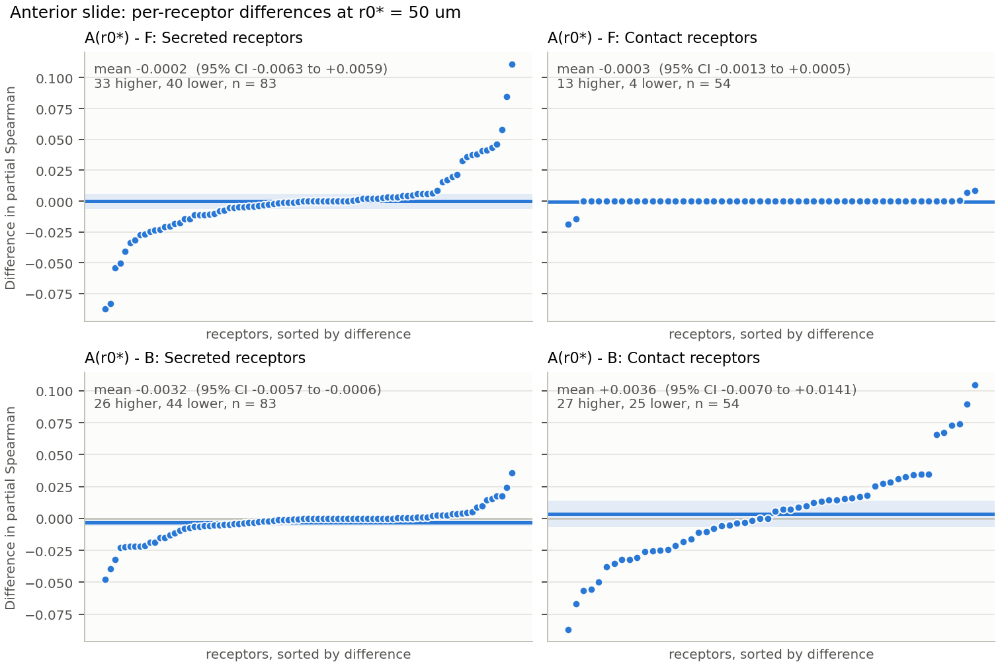

# r₀ 验证报告（第二阶段计划第 9 节）

**日期：** 2026-11-16（UTC）。**计划：** [`reports/stage2_plan.md`](../stage2_plan.md) 第 9 节（`45ee06a`，在启动任何新运行、做任何整张切片的靶基因评价之前提交）。
**结果目录：** 后部 [`reports/stage2_r0val_post/`](../stage2_r0val_post/)，前部 [`reports/stage2_r0val_ant/`](../stage2_r0val_ant/)。

## 结论

**按第 9.5 节的事先标准，判断为"部分满足"：前部切片上 (c)、(d) 满足，(a)、(b) 不满足。**

- 两项主要标准 (a)、(b) 在前部都不满足：A(r₀\*) 与 F、I、B 的平均差都在 0 附近（−0.0007 到 +0.0001），置信区间都包含 0。
- (c)、(d) 只是按字面规则满足：(c) 是 48 个受体对 45 个，与随机无法区分；(d) 中分泌型和接触型的平均差都略小于 0，两者几乎相同。
- 后部（选出 r₀\* 的同一张切片，只作探索）上四项都满足，但这个结果在前部没有重复出来。
- 后部选出的 r₀\* = 50 µm 在前部没有得到确认（第 8.9 节的严格确认和容差确认都不通过）。
- 坐标打乱对照按事先的规则判为"评价方法对空间信息敏感"，所以结论不加"评价方法的灵敏度不足"的注明。
  但打乱坐标后平均偏 Spearman 仍保留约 80%，这一点在第 5 节照实说明。

所以：**在当前评价下，没有独立切片上的证据表明 r₀ 核比平坦核、反比核或 COMMOT cost 更好。**

## 1. 做了什么

| 条件 | 含义 | 切片 |
|---|---|---|
| A | 本研究 cost，diffusion 为 log1p(d / r₀)，r₀ = 50、100、200、400 µm | 后部、前部 |
| F | 平坦核：截断（363.08 µm）内 cost 为 0 | 后部、前部 |
| I | 反比核：F(d) = min(1, d_ref / d)，d_ref 为最小非零 spot 间距（后部 99.48 µm，前部 99.53 µm） | 后部、前部 |
| B | COMMOT cost，纯 collective，不区分 contact 和 diffusion | 后部、前部 |
| P | 打乱 spot 坐标后跑 A（r₀ = 200 µm），种子 1、2、3 | 后部 |

全部条件 ε = 0.1、ρ = 10，截断 363.08 µm，求解设置相同。A、F、I、P 的 contact 部分完全相同，只有 diffusion 的核不同。

**评价：** 每个受体取前 10 个 TF，靶基因用平均表达，检测阈值 5%；主指标是受体层面偏 Spearman（控制受体表达）的平均值；
置信区间为受体层面 bootstrap（1000 次，种子 1）。配对比较只用所比较条件都有定义的受体：后部 137 个，前部 143 个。

**顺序：** 收敛判断（`7ff2bc7`）→ 后部评价一次、选出 r₀\*（`d1aac56`）→ 前部评价一次（`fd75068`）。
前部评价在后部 r₀\* 提交之后才启动，启动前没有运行或查看过前部的任何评价结果。

## 2. 收敛（第 8.7、9.2 节）

- 后部的 F、I、P1–P3 和前部的 F、I：两项质量守恒检查都在 1e-7 内通过，禁止连接上的质量都为 0。都达到迭代上限（50001 次），照实记录，不算失败。
- 稳定性诊断（后部，50000 次对 200000 次）：A（r₀ = 50、400）、B、F 都满足标准。224 个受体的最大相对 L1 差为 8.4e-7（标准 1e-3），
  Spearman 最小 0.99999999，总运输量相对差最大 2.6e-8。所以 A 族（含 I、P）、B 族和 F 的 50000 次结果都接受，没有重跑。
- 详细数字见计划第 9.9 节、[`reports/stage2_stability_01/`](../stage2_stability_01/stability.csv)。

## 3. 平均偏 Spearman 随 r₀ 的变化

### 3.1 后部（选择和探索）

| 条件 | 平均偏 Spearman（137 个受体） | 95% 区间 |
|---|---|---|
| **A，r₀ = 50 µm（r₀\*）** | **0.0484** | 0.0368–0.0617 |
| A，r₀ = 100 µm | 0.0475 | 0.0354–0.0611 |
| A，r₀ = 200 µm | 0.0471 | 0.0352–0.0606 |
| A，r₀ = 400 µm | 0.0461 | 0.0345–0.0595 |
| F（平坦核） | 0.0416 | 0.0304–0.0540 |
| I（反比核） | 0.0449 | 0.0332–0.0586 |
| B（COMMOT cost） | 0.0416 | 0.0281–0.0554 |
| 只用受体表达（普通 Spearman，不是偏相关） | 0.1437 | 0.1277–0.1608 |

- 按第 8.5 节选出 **r₀\* = 50 µm**。它是网格的最小值；四个 r₀ 之间最大只差 0.0023，远小于各自区间的宽度。
- "只用受体表达"是受体表达与靶基因得分的普通 Spearman，和偏相关不是同一个量，只作参照，不能直接和上面各行比大小。

### 3.2 前部（确认；曲线只作描述）

| 条件 | 平均偏 Spearman（143 个受体） | 95% 区间 |
|---|---|---|
| **A，r₀ = 50 µm（r₀\*）** | **0.0443** | 0.0336–0.0556 |
| A，r₀ = 100 µm | 0.0450 | 0.0340–0.0562 |
| A，r₀ = 200 µm | 0.0455 | 0.0344–0.0572 |
| A，r₀ = 400 µm | 0.0451 | 0.0335–0.0571 |
| F（平坦核） | 0.0441 | 0.0322–0.0567 |
| I（反比核） | 0.0448 | 0.0333–0.0567 |
| B（COMMOT cost） | 0.0450 | 0.0323–0.0579 |
| 只用受体表达（普通 Spearman） | 0.0966 | 0.0836–0.1089 |

- 前部上 A 的四个 r₀、F、I、B 全部落在 0.0441–0.0455 之间，彼此分不开。
- **第 8.9 节：** 前部按同一规则会选 r₀ = 200 µm；r₀\* = 50 µm 在前部四个 r₀ 中排最后。
  严格确认不通过；容差确认也不通过（与最佳的差 0.00119，大于 1 个 bootstrap 标准误 0.00090）。

## 4. 第 9.5 节逐项判断（前部，r₀\* = 50 µm）

| 标准 | 前部结果 | 判断 | 后部（探索） |
|---|---|---|---|
| (a) A(r₀\*) − F 平均差 > 0 且区间不含 0 | +0.0001（−0.0034 到 +0.0037） | **不满足** | +0.0069（+0.0036 到 +0.0107） |
| (b) A(r₀\*) − I | −0.0005（−0.0029 到 +0.0020） | **不满足** | +0.0035（+0.0011 到 +0.0061） |
| (b) A(r₀\*) − B | −0.0007（−0.0051 到 +0.0036） | **不满足** | +0.0068（+0.0025 到 +0.0116） |
| (c) A(r₀\*) 优于 F 的受体占多数 | 48 更高，45 更低，50 相同；p = 0.84 | 按字面满足 | 63 更高，26 更低，48 相同；p = 0.0001 |
| (d) 分泌型的提升大于接触型 | 分泌型 −0.0002，接触型 −0.0003；差 +0.0001（−0.0062 到 +0.0067） | 按字面满足 | 分泌型 +0.0119，接触型 +0.0003；差 +0.0116（+0.0057 到 +0.0183） |

**判断：部分满足（(c)、(d)）。** 需要照实说明的是：

- (c) 的规则是"差值 > 0 的受体数多于 < 0 的受体数"。48 对 45 满足这条字面规则，但二项检验 p = 0.84，不构成"占多数"的证据。
- (d) 的规则是分泌型的平均差大于接触型（点估计）。前部两类的平均差都是负的、都接近 0，两者之差的区间以 0 为中心，
  谈不上"分泌型上有提升"。
- 接触型受体作为内部对照的表现符合预期：A 和 F 的 contact 部分完全相同，两张切片上接触型的 A − F 都接近 0（前部 54 个里 37 个完全相同）。
- 后部一栏用的是选出 r₀\* 的同一份数据，偏向 A，只作探索，不作结论。

## 5. 按受体的配对差值

### 5.1 后部（探索）

### 5.2 前部（确认）

| 比较 | 受体类别 | 后部：平均差（区间）；更高 / 更低 / 相同 | 前部：平均差（区间）；更高 / 更低 / 相同 |
|---|---|---|---|
| A(r₀\*) − F | 分泌型 | +0.0119（+0.0064 到 +0.0182）；45 / 17 / 13 | −0.0002（−0.0063 到 +0.0059）；33 / 40 / 10 |
| A(r₀\*) − F | 接触型 | +0.0003（−0.0009 到 +0.0015）；13 / 7 / 35 | −0.0003（−0.0013 到 +0.0005）；13 / 4 / 37 |
| A(r₀\*) − F | 两类都有 | +0.0051（−0.0037 到 +0.0126）；5 / 2 / 0 | +0.0089（−0.0021 到 +0.0244）；2 / 1 / 3 |
| A(r₀\*) − B | 分泌型 | +0.0008（−0.0018 到 +0.0034）；31 / 33 / 11 | −0.0032（−0.0057 到 −0.0006）；26 / 44 / 13 |
| A(r₀\*) − B | 接触型 | +0.0179（+0.0080 到 +0.0274）；38 / 16 / 1 | +0.0036（−0.0070 到 +0.0141）；27 / 25 / 2 |
| A(r₀\*) − B | 两类都有 | −0.0143（−0.0291 到 −0.0012）；1 / 6 / 0 | −0.0063（−0.0231 到 +0.0044）；1 / 2 / 3 |

受体数：后部分泌型 75、接触型 55、两类都有 7；前部 83、54、6。每个受体的数值在两个目录的 `differences_receptors.csv`。

- **后部上 A 对 B 的优势来自接触型受体，不来自分泌型受体。** 后部分泌型的 A − B 为 +0.0008，区间包含 0；接触型为 +0.0179。
  A 和 B 在接触型受体上的差别是"contact 只连相邻 spot"对"363 µm 内都能连"，和 r₀ 核无关。
- **前部分泌型受体上 A(r₀\*) 低于 B**（−0.0032，区间不包含 0；26 个更高，44 个更低）。
- A(r₀\*) − I 的分组结果在 `differences.csv`：后部分泌型 +0.0054（+0.0014 到 +0.0101），前部分泌型 −0.0014（−0.0049 到 +0.0024）。

## 6. 坐标打乱对照（后部，第 9.6 节）

| | 平均偏 Spearman（137 个受体） | 95% 区间 |
|---|---|---|
| A，r₀ = 200 µm，未打乱 | 0.0471 | 0.0352–0.0606 |
| P，种子 1 | 0.0377 | 0.0284–0.0485 |
| P，种子 2 | 0.0365 | 0.0272–0.0470 |
| P，种子 3 | 0.0387 | 0.0292–0.0490 |

| 差值 | 平均差 | 95% 区间 |
|---|---|---|
| **A(200) − 三个种子的平均** | **+0.0095** | +0.0029 到 +0.0163 |
| A(200) − P1 | +0.0095 | +0.0027 到 +0.0166 |
| A(200) − P2 | +0.0106 | +0.0039 到 +0.0176 |
| A(200) − P3 | +0.0085 | +0.0011 到 +0.0159 |

- **按事先的规则：** 差值的区间不包含 0，评价方法对空间信息敏感，第 4 节的结论不加"评价方法的灵敏度不足"的注明。
- **规则之外需要说明的观察：** 坐标完全打乱后，平均偏 Spearman 仍有 0.0376，是未打乱时的约 80%。
  也就是说，这个指标的大部分数值不依赖 spot 的真实位置；真实空间信息贡献的部分约为 0.0095。
  第 3 节里各条件之间的差（后部最大 0.007，前部最大 0.0014）是在这 0.0095 的范围内比较的。
- 核确实明显改变了运输方案：diffusion 部分的平均运输距离，后部 A（r₀ = 50）为 55 µm、I 为 106 µm、F 为 261 µm（前部 45、102、260 µm），
  而总运输量几乎不变（后部 138,334–138,341）。运输距离差了近 5 倍，平均偏 Spearman 在前部却基本不变。
- 以上两点是观察，不是事先定好的判断；是否据此调整评价方法，需要另行决定并事先登记。

## 7. 敏感性：COMMOT 靶基因规则（第 8.8 节，不参与判断）

可评价的受体少得多（后部 76 个，前部 86 个）。

| | 后部 | 前部 |
|---|---|---|
| 按同一规则选出的 r₀ | 50 µm | 100 µm |
| A(r₀\*) − F | +0.0045（−0.0006 到 +0.0103） | +0.0025（−0.0015 到 +0.0069） |
| A(r₀\*) − I | +0.0036（+0.0001 到 +0.0078） | +0.0002（−0.0029 到 +0.0038） |
| A(r₀\*) − B | +0.0024（−0.0032 到 +0.0085） | −0.0010（−0.0052 到 +0.0035） |
| A 优于 F 的受体 | 31 更高，17 更低，28 相同；p = 0.06 | 32 更高，29 更低，25 相同；p = 0.80 |
| 分泌型 / 接触型的 A − F | +0.0052 / −0.0002 | +0.0010 / 0.0000 |
| 逐项结果 | (c)、(d) 满足 | (c)、(d) 满足 |
| 打乱对照 A(200) − P | +0.0072（+0.0002 到 +0.0141） | 不适用 |

- 方向和主分析一致：前部上 (a)、(b) 都不满足。
- 在这条规则下，后部的 (a) 和 (b) 中对 B 的比较也不满足。
- 打乱对照的差值区间刚好不包含 0；单个种子里，种子 1 和种子 3 的区间包含 0。

## 8. 本判断之外的相关观察

第 8 节的敏感性条件 Aε、Bε（ε = 0.2、ρ = 1）不在第 9 节的检验范围内，这里只记录现象，完整结果在第 8 节报告里。

- 在这组参数下，A 的平均偏 Spearman 随 r₀ 增大而下降，两张切片方向一致：后部 0.096 → 0.082（r₀ 从 50 到 400 µm），前部 0.088 → 0.080。
- 这组参数没有跑平坦核和反比核，所以不能据此判断 r₀ 核在这组参数下是否有用。要回答这个问题需要新的、事先登记的运行。

## 9. 偏离计划的地方

1. **稳定性判断代码的修正（`db64797`）。** `stage2.py stability` 第一次用于 F 时发现：对没有 r₀ 的条件（B、F）匹配不到任何受体，
   会在没有比较的情况下判为"稳定"。在记录任何 8.7 判断之前修正并加了测试。报告中 B、F 的 224 个受体是修正后的实际比较。
2. **曲线图标题的修改（`b207273`）。** 后部结果生成后，发现曲线图的标题被截断，只改了标题的换行。改后重新生成，后部的 8 个结果表与改前逐字节相同。
   前部的图用的是改后的代码。
3. **B 的 200000 次诊断比估计的慢。** 实际求解 86,263 秒（约 24 小时）。收敛判断和后部评价因此推迟到 11-16 03:43 之后，顺序没有变化。
4. **等待程序三次随会话结束而停止。** 运行本身以脱离会话的方式启动，不受影响；没有运行失败或重跑。
5. **小区域流程测试。** 11-14 在 128 个 spot 的小区域上做过一次流程测试，其中的相关系数没有显示过；用户已确认这不算整张切片的评价。
6. **(c)、(d) 的"按字面满足"。** 判断严格按第 9.5 节补充的字面规则给出，没有改规则；它们不构成证据这一点在第 4 节单独说明。
7. **没有改动的地方：** r₀ 网格、r₀ 选择规则、评价规则、判断标准、bootstrap 设置都和计划一致。后部和前部的评价各只运行了一次。
